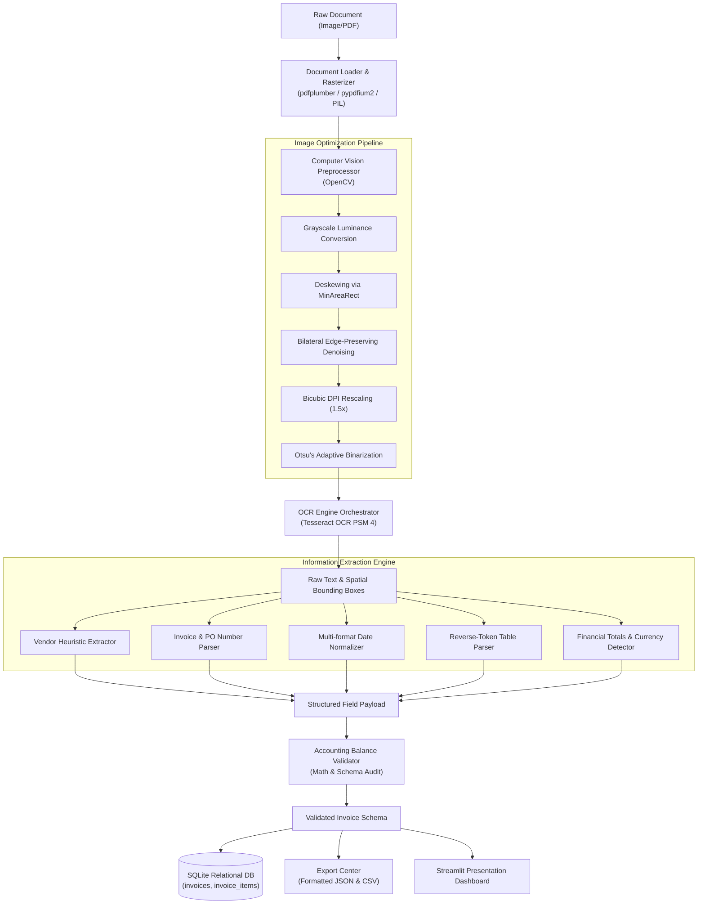

# Automated Invoice Data Extraction & Structuring System
### *Day 6 — 90 Days / 90 Projects Challenge*

[](https://www.python.org/)
[](https://streamlit.io/)
[](https://opencv.org/)
[](https://www.sqlite.org/)
[](https://pytest.org/)
[](LICENSE)

An end-to-end Computer Vision and FinTech automation pipeline that ingests invoice images (PNG, JPG, TIFF) and digital PDFs, applies image enhancement filters, extracts text using Tesseract OCR, parses business entities and line items using rule-based NLP, verifies accounting equations, and persists validated records in an SQLite database with JSON and CSV exports.

---

## 1. Problem Statement & Motivation
In modern accounts payable (AP) departments, transcribing physical, scanned, and emailed invoices into ERP systems remains an expensive, error-prone manual bottleneck:
- **High Transaction Costs**: Manual invoice entry costs organizations between \$12 to \$30 per invoice in labor.
- **Data Entry Errors**: Minor transcription errors in invoice numbers or decimal amounts lead to costly vendor payment disputes and duplicate disbursements.
- **Processing Delays**: Manual processing takes days, causing companies to miss early-payment discounts and strain vendor relationships.

This project automates invoice data ingestion, transcription, mathematical reconciliation, and structured storage in a transparent, locally runnable application.

---

## 2. Objectives & Intended Users
- **Primary Objective**: Ingest an invoice document and extract key fields (Vendor, Invoice Number, Invoice Date, Due Date, Financial Breakdown, and Itemized Line Items) with verified mathematical integrity.
- **Intended Users**:
  - Accounts Payable (AP) and procurement automation teams.
  - Small business owners managing vendor disbursements.
  - Recruiters and engineering managers evaluating AI/Data Science, Computer Vision, and Python software engineering competency.

---

## 3. Key Features
- **Multi-Format Document Ingestion**: Supports high-resolution scans, smartphone photographs (`.png`, `.jpg`, `.jpeg`, `.tiff`), and multi-page vector PDFs (`.pdf`).
- **Computer Vision Preprocessing Pipeline**:
  - *Luminance Grayscale Conversion*.
  - *Foreground Deskewing via Minimum Area Bounding Box* ($\pm 30^\circ$ rotation correction).
  - *Bilateral Edge-Preserving Denoising* (removes background speckles without blurring font strokes).
  - *Bicubic DPI Rescaling* ($1.5\times$ upscaling for small receipt numbers).
  - *Otsu & Adaptive Gaussian Binarization* (handles uneven shadows from camera photos).
- **Tesseract OCR Integration**: Uses Page Segmentation Mode 4 (`--psm 4`) for multi-column invoice layouts, extracting text and word-level coordinates with confidence metrics.
- **Rule-Based NLP & Entity Extraction**:
  - *Vendor Name*: Header-section heuristics excluding document stopwords ("TAX INVOICE", "BILL TO") and prioritizing business suffixes (`LLC`, `Inc`, `Technologies`, `Partners`).
  - *Invoice & PO Numbers*: Multi-pattern regular expressions matching alphanumeric identifiers (`INV-XXXX-XXX`, `#XXXXX`, `PO-XXXXX`).
  - *Dates*: Fuzzy parser converting ISO, European, American, and verbal dates to standard `YYYY-MM-DD`.
  - *Itemized Table Parser*: Right-to-left reverse token analysis separating product descriptions from quantity, unit price, and line totals.
- **Accounting Reconciliation Engine**: Enforces mathematical balance:
  $$\text{Subtotal} + \text{Tax} + \text{Shipping} - \text{Discount} = \text{Total Amount Due}$$
  Automatically assigns audit ratings: `EXCELLENT` ($0 discrepancy), `GOOD`, or `NEEDS_REVIEW`.
- **Human-in-the-Loop Review & Editing**: Interactive Streamlit form and editable data grid allowing operators to tweak extracted values before committing to the database.
- **Relational SQLite Persistence**: Stores validated records across normalized tables (`invoices`, `invoice_items`) with cascading foreign keys.
- **Multi-Format Export Center**: One-click downloads for full structured JSON, summary CSV, and detailed item-level CSV files.
- **Executive Analytics Dashboard**: Real-time KPI metrics (Total Invoiced, Total Spend, Average Invoice Amount, Validation Pass Rate, Top Vendors).

---

## 4. Architecture Overview



---

## 5. Technology Stack
| Layer | Technologies & Libraries | Purpose |
| :--- | :--- | :--- |
| **Frontend UI** | Streamlit, HTML/CSS | Modern web presentation, multi-tab workflow, interactive data grid |
| **Computer Vision** | OpenCV (`opencv-python`), Pillow | Image preprocessing (deskew, bilateral denoise, Otsu binarization) |
| **OCR Engine** | Tesseract OCR 5.4, `pytesseract` | Optical character recognition, bounding box extraction, confidence scores |
| **Document Processing**| `pdfplumber`, `pypdf`, `pypdfium2` | PDF parsing, embedded text extraction, high-DPI rasterization |
| **Entity Extraction** | Python `re`, `python-dateutil` | Regular expressions, date normalization, reverse tokenization |
| **Data Validation** | Pydantic v2 | Schema enforcement, typed contracts, validation scoring |
| **Database** | SQLite 3 | Embedded relational storage with cascading foreign keys |
| **Data & Exports** | Pandas, JSON | Tabular aggregations, summary CSV, detailed CSV, JSON exports |
| **Sample Generation** | ReportLab | Programmatic generation of realistic synthetic invoice PDFs & PNGs |
| **Testing** | `pytest`, `pytest-cov` | Automated unit, integration, and end-to-end regression tests |

---

## 6. Project Directory Structure
```text
90-days-90-projects-day-06-invoice-ocr-extractor/
├── .env.example                     # Environment configuration template
├── .gitignore                       # Git ignore specifications
├── LICENSE                          # MIT Open Source License
├── README.md                        # Master project documentation
├── QUICKSTART.md                    # Rapid setup instructions
├── DEMO_SCRIPT.md                   # 60-120 second interview presentation script
├── pyproject.toml                   # Project metadata & pytest configuration
├── requirements.txt                 # Pinned dependencies
├── setup.bat                        # Windows 1-click automated setup
├── run.bat                          # Windows 1-click application launcher
├── test.bat                         # Windows automated test runner
├── app.py                           # Main Streamlit web application
├── config.py                        # Configuration loader & Tesseract path resolver
├── src/
│   ├── __init__.py
│   ├── ocr/
│   │   ├── __init__.py
│   │   ├── preprocessor.py          # OpenCV computer vision pipeline
│   │   ├── engine.py                # Tesseract OCR engine orchestrator
│   │   └── pdf_processor.py         # PDF digital extraction & page rasterization
│   ├── parser/
│   │   ├── __init__.py
│   │   ├── regex_patterns.py        # Regular expression catalog for invoices
│   │   ├── nlp_helpers.py           # Vendor heuristics, currency & date normalizers
│   │   ├── table_parser.py          # Right-to-left reverse token table parser
│   │   └── extractor.py             # Master field extractor orchestrator
│   ├── validator/
│   │   ├── __init__.py
│   │   ├── math_validator.py        # Accounting balance reconciliation check
│   │   └── schema_validator.py      # Pydantic schemas & audit grading
│   ├── database/
│   │   ├── __init__.py
│   │   ├── models.py                # SQLite schema DDL (invoices, invoice_items)
│   │   └── repository.py            # CRUD repository & analytics aggregations
│   └── exporter/
│       ├── __init__.py
│       ├── json_exporter.py         # Formatted JSON serializer
│       └── csv_exporter.py          # Summary & detailed CSV exporter
├── data/
│   ├── README.md                    # Dataset origin & schema documentation
│   ├── invoices.db                  # Local SQLite database (seeded with samples)
│   └── sample_invoices/             # 5 curated synthetic invoice PDFs & PNGs
├── scripts/
│   ├── generate_sample_invoices.py  # Generates realistic synthetic PDFs & PNGs
│   ├── seed_database.py             # Seeds SQLite database with sample records
│   └── verify_tesseract.py          # Tesseract installation verification utility
├── tests/
│   ├── __init__.py
│   ├── test_preprocessor.py         # Tests for computer vision functions
│   ├── test_engine.py               # Tests for OCR extraction & bounding boxes
│   ├── test_extractor.py            # Tests for regex patterns & field parsing
│   ├── test_table_parser.py         # Tests for line item table parsing
│   ├── test_math_validator.py       # Tests for financial reconciliation checks
│   ├── test_database.py             # Tests for SQLite schema, CRUD & analytics
│   ├── test_exporter.py             # Tests for JSON & CSV exporters
│   └── test_e2e_pipeline.py         # End-to-end integration test
├── docs/
│   ├── PROJECT_OVERVIEW.md          # Business problem, solution & scope
│   ├── ARCHITECTURE.md              # Technical design, Mermaid flowcharts & ERD
│   ├── USER_GUIDE.md                # Walkthrough of all UI screens & features
│   ├── DEVELOPMENT_NOTES.md         # Design decisions, trade-offs & rationale
│   ├── TESTING.md                   # Complete test execution logs & cases
│   └── TROUBLESHOOTING.md           # Common issues & step-by-step fixes
└── screenshots/                     # UI visual captures
```

---

## 7. Screenshots & Interface Preview

| Screen | Description | Path |
| :--- | :--- | :--- |
| **Document Processing & Bounding Boxes** | Side-by-side original invoice preview with color-coded OCR confidence bounding boxes (Green/Orange/Red) | `screenshots/dashboard.png` |
| **Extracted Data & Math Verification** | Extracted vendor, invoice number, dates, line items, and the accounting balance equation | `screenshots/extracted_data.png` |
| **Database & Analytics Dashboard** | SQLite records table, spend by vendor metrics, and export center | `screenshots/database_analytics.png` |

> *To capture live screenshots: Launch `run.bat`, open `http://localhost:8501`, and save captures into `screenshots/`.*

---

## 8. Prerequisites
- **Operating System**: Windows 10 or 11 (64-bit). Also compatible with macOS and Linux.
- **Python**: Version 3.10, 3.11, or 3.12 (Tested on Python 3.12.6).
- **Tesseract OCR**:
  - Windows: Install via winget:
    ```cmd
    winget install UB-Mannheim.TesseractOCR --accept-source-agreements --accept-package-agreements
    ```
  - Standard Path: `C:\Program Files\Tesseract-OCR\tesseract.exe`.

---

## 9. Step-by-Step Windows Installation

### Automated Setup (Recommended)
Simply run the included batch script:
```cmd
setup.bat
```
This script will:
1. Verify Python 3.10+ installation.
2. Create an isolated virtual environment (`.venv`).
3. Upgrade pip and install all pinned dependencies from `requirements.txt`.
4. Copy `.env.example` to `.env` if not present.
5. Verify Tesseract OCR binary path.
6. Generate sample invoices and seed the SQLite database.

### Manual Setup
```cmd
# 1. Clone or navigate to the project directory
cd "90-days-90-projects-day-06-invoice-ocr-extractor"

# 2. Create isolated virtual environment
py -3.12 -m venv .venv

# 3. Activate virtual environment
.venv\Scripts\activate

# 4. Install dependencies
python -m pip install --upgrade pip
pip install -r requirements.txt

# 5. Initialize environment configuration
copy .env.example .env

# 6. Generate synthetic sample invoices & seed database
python scripts\generate_sample_invoices.py
python scripts\seed_database.py
```

---

## 10. Quick Start Commands
```cmd
# Start the Streamlit application
run.bat

# Or run via terminal
.venv\Scripts\streamlit.exe run app.py
```
Open **`http://localhost:8501`** in your web browser.

---

## 11. Environment Variables & `.env.example`
The project reads configurations from `.env` using `python-dotenv`:
```env
# Application Settings
APP_NAME="Automated Invoice Data Extraction & Structuring System"
APP_ENV=development
DEBUG=True

# Path to Tesseract executable (leave empty for auto-detection)
TESSERACT_CMD=C:\Program Files\Tesseract-OCR\tesseract.exe

# Database Path
DATABASE_PATH=data/invoices.db

# Processing Settings
CONFIDENCE_THRESHOLD=0.60
ALLOWED_EXTENSIONS=png,jpg,jpeg,tiff,pdf
MAX_FILE_SIZE_MB=10
```

---

## 12. Dataset & Sample Invoices
The project includes 5 synthetic sample invoices in `data/sample_invoices/` (both PDF and PNG formats):
1. **`INV-2026-001_Apex_Hardware`**: Hardware peripherals with 3 itemized rows, tax, shipping, and PO number.
2. **`INV-2026-002_CloudScale_Technologies`**: Cloud SaaS subscription with voucher discount and tax.
3. **`INV-2026-003_Quantum_Consulting`**: Professional consulting hours with hourly billing and Net 30 terms.
4. **`INV-2026-004_Metro_Office_Supplies`**: Office supplies order with purchase order reference (`PO-88421`).
5. **`INV-2026-005_CyberShield_Security`**: Software licenses with annual seats and security subscriptions.

*All samples are 100% synthetic, contain zero real PII, and are MIT-licensed.*

---

## 13. Example Input & Output

### Input Document Preview:
```text
Apex Hardware Labs LLC
104 Technology Drive, Suite 400, San Jose, CA 95110
TAX INVOICE

Invoice No: INV-2026-001          Invoice Date: 2026-10-15
Due Date: 2026-11-14              PO Number: PO-99120
Terms: Net 30

Description                       Qty   Unit Price   Total Amount
Dell UltraSharp 27 4K Monitor      2     $450.00      $900.00
Ergonomic Mechanical Keyboard      3      $85.00      $255.00
USB-C Dual Display Docking Station 2     $120.00      $240.00

Subtotal: $1,395.00
Shipping & Handling: $25.00
Tax (VAT/GST): $111.60
Total Amount Due: $1,531.60
```

### Extracted Structured JSON Output:
```json
{
  "vendor_name": "Apex Hardware Labs LLC",
  "invoice_number": "INV-2026-001",
  "invoice_date": "2026-10-15",
  "due_date": "2026-11-14",
  "currency": "USD",
  "subtotal": 1395.0,
  "tax_amount": 111.6,
  "shipping_amount": 25.0,
  "discount_amount": 0.0,
  "total_amount": 1531.6,
  "payment_terms": "Net 30",
  "po_number": "PO-99120",
  "overall_confidence": 0.86,
  "validation_status": "VALIDATED",
  "line_items": [
    {
      "description": "Dell UltraSharp 27 4K Monitor",
      "quantity": 2.0,
      "unit_price": 450.0,
      "amount": 900.0
    },
    {
      "description": "Ergonomic Mechanical Keyboard",
      "quantity": 3.0,
      "unit_price": 85.0,
      "amount": 255.0
    },
    {
      "description": "USB-C Dual Display Docking Station",
      "quantity": 2.0,
      "unit_price": 120.0,
      "amount": 240.0
    }
  ]
}
```

---

## 14. Testing & Verification Status
Run the automated test suite on Windows:
```cmd
test.bat
```
**Actual Test Results:**
- **Status: 27 / 27 Tests PASSED (100% Pass Rate)**
- **Execution Time**: ~2.87 seconds
- Modules Verified: Preprocessor, OCR Engine, Regex Patterns, NLP Helpers, Table Parser, Math Reconciliation, SQLite Repository, Exporters, and End-to-End Integration.

---

## 15. Known Limitations
1. **Handwritten Invoices**: Tesseract OCR is optimized for printed typographic text. Handwritten receipts may require specialized handwriting models (e.g. TrOCR).
2. **Severely Degraded Paper**: Invoices with deep physical creases, water damage, or extreme camera blur may require manual field adjustment in Tab 3.
3. **Multi-page Spanning Tables**: Line items spanning across 5+ consecutive pages are parsed page-by-page rather than aggregated into a continuous stream.

---

## 16. Troubleshooting
- **Tesseract Not Found**: Ensure Tesseract is installed and path is verified via `.venv\Scripts\python.exe scripts\verify_tesseract.py`.
- **Uneven Lighting**: Switch **Thresholding Mode** in the sidebar to `adaptive` to handle phone camera shadows.
- See [`docs/TROUBLESHOOTING.md`](docs/TROUBLESHOOTING.md) for detailed diagnostics.

---

## 17. Security & Privacy Considerations
- **Local Processing**: All document OCR and data parsing run 100% locally on your machine. No document images or extracted data are sent to third-party cloud APIs.
- **No Hardcoded Secrets**: Secrets and local paths are isolated in `.env` (gitignored).
- **SQL Injection Prevention**: All database queries use parameterized SQL prepared statements (`?` placeholders).

---

## 18. Future Enhancements
- **Transformer-based Document AI**: Incorporate LayoutLMv3 or Donut for end-to-end multi-modal vision-language understanding.
- **Direct ERP Connectors**: Add automated Webhook / REST sync to QuickBooks Online and Xero.
- **Multilingual Support**: Integrate Tesseract language packs for French, German, Spanish, and Hindi invoices.

---

## 19. Learning Outcomes
- **Computer Vision Engineering**: Practical application of morphological operations, Otsu binarization, affine transformations for deskewing, and bilateral edge-preserving filters.
- **OCR Orchestration**: Managing Tesseract page segmentation modes (PSM 4 vs PSM 3) and extracting spatial coordinates with confidence intervals.
- **Information Extraction**: Designing multi-pattern regex engines and right-to-left reverse tokenization for table parsing.
- **Financial Domain Rules**: Implementing automated mathematical reconciliation to prevent hallucinated data.

---

## 20. Technical Skills & Resume Keywords
`OCR`, `Tesseract`, `OpenCV`, `Computer Vision`, `Document AI`, `Information Extraction`, `Regex`, `Python`, `Streamlit`, `SQLite`, `Pydantic`, `FinTech Automation`, `ETL Pipelines`, `Unit Testing (pytest)`.

---

## 21. License & Attribution
This project is open-source under the [MIT License](LICENSE). Developed as part of the **90 Days – 90 Projects Challenge** by **raguramrrp**.
