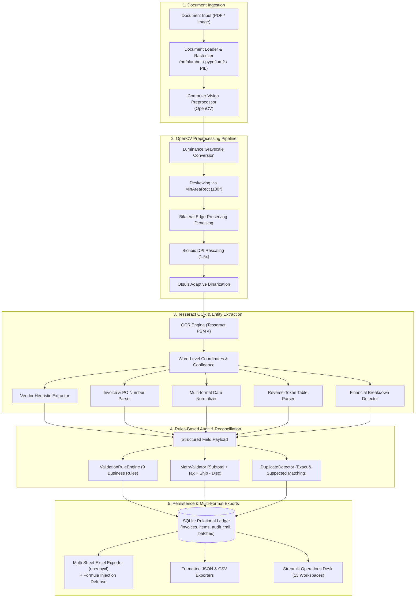
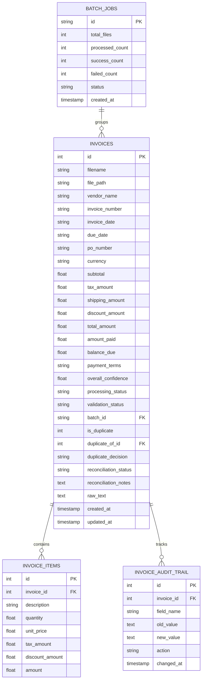

# System Architecture & Technical Specifications
### *INVOICE INTELLIGENCE — Document Processing & Financial Operations*

---

## 1. Architectural Overview

The system follows a modular, layered architecture that strictly separates user interface, computer vision preprocessing, OCR extraction, rules-based validation, financial reconciliation, and relational persistence.



---

## 2. Information Architecture (13 Workspaces)

The platform is structured into 4 operational domains:

```text
├── WORKSPACE
│   ├── Overview                  # Actionable Operations Desk & Pipeline Progress
│   ├── My Work Queue             # Task-oriented exception inbox (Priority-sorted)
│   ├── All Invoices              # Complete searchable relational ledger
│   └── Vendors                   # Counterparty directory & normalization tool
├── DOCUMENT OPERATIONS
│   ├── Import Center             # Multi-document ingestion & isolated batch queue
│   ├── Extraction Studio         # Split-screen review workstation
│   ├── Validation & Exceptions   # Rules-based audit engine
│   └── Duplicate Review          # Side-by-side candidate pair comparison
├── FINANCIAL OPERATIONS
│   ├── Reconciliation            # Invoice-level financial consistency workspace
│   ├── Financial Insights        # Currency-segregated analytics & spend trends
│   └── Reports & Exports         # Excel (.xlsx), CSV, and JSON export center
└── SYSTEM
    ├── Activity & Audit          # Full governance trail & batch logs
    └── Settings                  # System diagnostics & sample database re-seeding
```

---

## 3. Relational Database Schema & ER Diagram



---

## 4. Component Breakdown & Engineering Implementation

### 4.1 OCR Preprocessing (`src/ocr/preprocessor.py`)
- **Auto-Deskewing**: Uses binary contour analysis and `cv2.minAreaRect` to calculate document tilt ($\pm 30^\circ$) and corrects tilt with `cv2.warpAffine` using cubic interpolation.
- **Bilateral Filtering**: `cv2.bilateralFilter(d=9, sigmaColor=75, sigmaSpace=75)` removes scanner noise and paper texture without rounding sharp character strokes.
- **Binarization**: Implements Otsu's thresholding for standard documents and adaptive Gaussian thresholding for camera photos with uneven shadows.
- **Resolution Rescaling**: Multiplies image dimensions by $1.5\times$ with bicubic interpolation for small receipt fonts.

### 4.2 OCR Engine & Page Segmentation (`src/ocr/engine.py`)
- Configured with Tesseract Page Segmentation Mode 4 (`--psm 4`), which reads horizontally across variable column widths to keep descriptions and prices together on the same text line.
- Generates word-level coordinates and confidence scores for color overlays (Green $\ge 80\%$, Amber $50\text{--}79\%$, Red $< 50\%$).

### 4.3 Table Parser (`src/parser/table_parser.py`)
- Implements right-to-left reverse token analysis. Because product descriptions often contain numbers (e.g. `Dell UltraSharp 27 4K Monitor`), right-to-left parsing extracts line totals, unit prices, and quantities from the end of the line, leaving the description intact.

### 4.4 Rules-Based Validation Engine (`src/validator/rule_engine.py`)
- Evaluates 9 deterministic business rules:
  1. `RULE_MISSING_VENDOR`: Critical check for unrecognized vendor.
  2. `RULE_MISSING_INVOICE_NO`: Critical check for missing invoice number.
  3. `RULE_MISSING_DATE`: Critical check for missing invoice date.
  4. `RULE_ZERO_TOTAL`: Critical check for zero or negative grand totals.
  5. `RULE_DATE_CHRONOLOGY`: Warning check for due date preceding issue date.
  6. `RULE_MATH_IMBALANCE`: Critical check for discrepancy in $\text{Subtotal} + \text{Tax} + \text{Shipping} - \text{Discount} = \text{Total}$.
  7. `RULE_ITEMS_SUBTOTAL_MISMATCH`: Warning check for sum of line items vs subtotal.
  8. `RULE_LINE_ITEM_ARITHMETIC`: Info check for $\text{Qty} \times \text{Unit Price} \ne \text{Line Total}$.
  9. `RULE_POTENTIAL_DUPLICATE`: Critical check for duplicate candidate matches.

### 4.5 Duplicate Detection Engine (`src/validator/duplicate_detector.py`)
- Normalizes vendor names (removes legal suffixes like `LLC`, `Inc`, punctuation, spaces) and invoice numbers (removes symbols and leading zeroes).
- Detects exact matches (same vendor + invoice number) and suspected matches (same vendor + invoice date + total amount).
- Supports systematic candidate pair discovery via `find_all_duplicate_pairs`.

### 4.6 Excel Workbook Exporter (`src/exporter/excel_exporter.py`)
- Builds multi-sheet formatted workbooks using `openpyxl`:
  - `Invoices Register`: Formatted overview with currency styling.
  - `Itemized Line Items`: Flattened line-item catalog.
  - `Audit Summary`: High-level operational metrics.
  - `Validation Exceptions`: All active exceptions from the rule engine.
  - `Duplicate Review Candidates`: Side-by-side duplicate candidate pairs.
- **Formula Injection Defense**: Escapes spreadsheet command triggers (`=`, `+`, `-`, `@`, `\t`, `\r`) with single quotes (`'`) to neutralize malicious DDE execution vulnerabilities.
