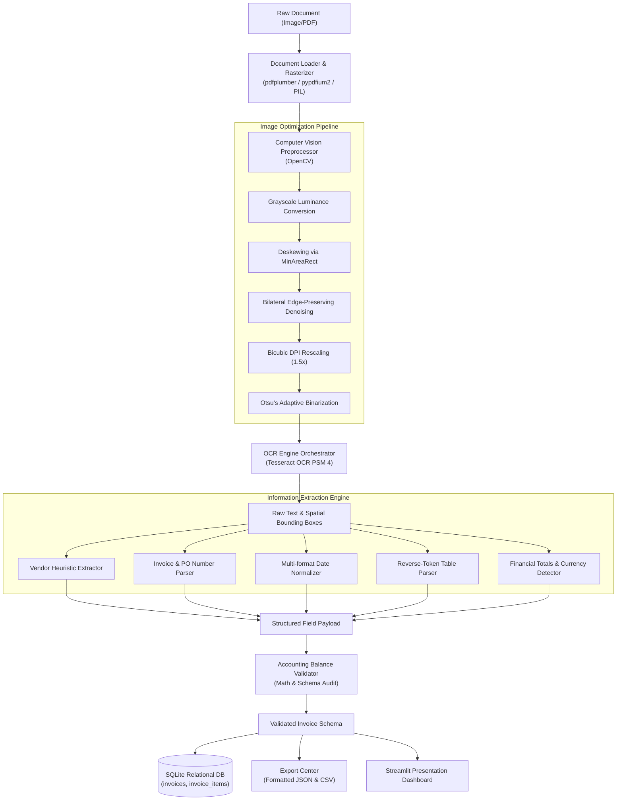
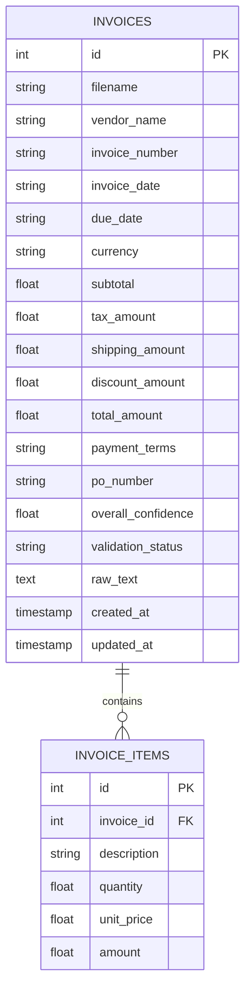

# System Architecture & Technical Specifications

## 1. Architectural Overview
The system follows a modular, layered architecture that isolates raw document handling, computer vision pre-processing, character recognition, rule-based parsing, validation logic, and data persistence.

---

## 2. Component Breakdown

### 2.1 OCR Preprocessing Module (`src/ocr/preprocessor.py`)
- **Grayscale Conversion**: Eliminates color channels while preserving luminance contrast.
- **Auto-Deskewing**: Uses foreground binary contour analysis and `cv2.minAreaRect` to calculate document tilt (up to $\pm 30^\circ$) and corrects tilt with `cv2.warpAffine` using cubic interpolation.
- **Denoising**: Employs `cv2.bilateralFilter(d=9, sigmaColor=75, sigmaSpace=75)` to smooth background grain and paper speckles without rounding sharp letter strokes.
- **Binarization**: Implements Otsu's thresholding (`cv2.THRESH_BINARY + cv2.THRESH_OTSU`) for uniform contrast and adaptive Gaussian thresholding for photos with uneven shadows.
- **Resolution Rescaling**: Multiplies image dimensions by $1.5\times$ with bicubic interpolation, providing sufficient pixel density for small 6–8pt font numbers.

### 2.2 OCR Engine Orchestrator (`src/ocr/engine.py`)
- Interfaces with the local Tesseract binary via `pytesseract`.
- Configured with Page Segmentation Mode 4 (`--psm 4`), which treats multi-column invoice layouts as single-column lines of variable sizes, preventing the separation of item descriptions from their corresponding prices.
- Extracts word-level coordinates and confidence metrics (`image_to_data`), rendering visual color overlays (Green $\ge 80\%$, Orange $50\text{--}79\%$, Red $< 50\%$).

### 2.3 Information Extraction Module (`src/parser/`)
- **`regex_patterns.py`**: Prioritized regular expression patterns for labeled invoice numbers (`\b(?:invoice|inv|bill)\s*(?:no|number|#)\s*[:.\-]?\s*([A-Za-z0-9\-/_]{3,25})`), dates, currency codes, PO references, and financial terms.
- **`nlp_helpers.py`**:
  - `clean_amount`: Normalizes currency signs, commas, and European/American decimal formats.
  - `parse_date_to_iso`: Uses `python-dateutil` to convert ambiguous date strings (e.g. `22/10/2026`, `Oct 15, 2026`, `2026-10-15`) into ISO `YYYY-MM-DD`.
  - `extract_vendor_heuristic`: Scans the top 12 lines, filters out document stopwords ("INVOICE", "BILL TO", "PAGE 1"), prioritizes company suffixes (`LLC`, `Inc`, `Technologies`, `Partners`), and strips attached document titles.
- **`table_parser.py`**: Implements right-to-left reverse token analysis. Because product descriptions can contain digits (e.g. `Dell 27 4K Monitor`), right-to-left parsing extracts line totals and unit prices from the end of the line, leaving the full product string intact.

### 2.4 Accounting Balance Validator (`src/validator/`)
- **Mathematical Balance Rule**:
  $$\Delta = \text{Total} - (\text{Subtotal} + \text{Tax} + \text{Shipping} - \text{Discount})$$
  If $|\Delta| \le 0.05$, the invoice receives a `PASSED` audit status. If $|\Delta| > 0.05$, the system flags a `DISCREPANCY` with the exact difference amount.
- **Line Items Check**: Compares the sum of extracted item totals against the extracted subtotal.
- **Schema Enforcement**: Pydantic dataclasses validate field types and assign an overall audit grade (`EXCELLENT`, `GOOD`, `NEEDS_REVIEW`).

### 2.5 Relational Database Module (`src/database/`)
- **Engine**: SQLite 3 with foreign key enforcement (`PRAGMA foreign_keys = ON`).
- **Entity Relationship Model**:

### 2.6 Exporter Module (`src/exporter/`)
- **JSON Exporter**: Serializes hierarchical invoice records with nested line items into indented JSON format.
- **CSV Exporter**: Generates both summary metadata tables and normalized, flattened line-item audit spreadsheets.
